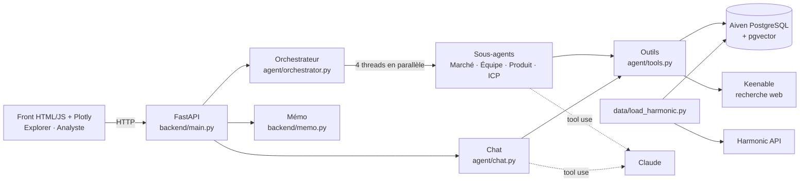

# Architecture

## Vue d'ensemble

## Flux

**1. Explorer.** `GET /startups` lit la table `startups`, qui est remplie par
`data/load_harmonic.py` (Harmonic, avec cache disque) ou par l'échantillon JSON de secours.
Le front construit le treemap secteur → startups.

**2. Analyse** (`POST /analyze/{id}`).
- L'orchestrateur relance seulement les pods vides ou dont les faits ont plus de `FACT_MAX_AGE_DAYS` jours.
- Chaque sous-agent suit la même méthode :
  1. il lit la fiche et ce qui est déjà en base (`get_startup_profile`, `search_knowledge`) ;
  2. si des informations manquent, il complète par le web (`web_search`). Chaque résultat est stocké
     dans `sources` et `chunks`, avec sa date de récupération ;
  3. il enregistre 4 à 8 faits avec `save_fact`.
- **Garde-fou** : `save_fact` refuse toute URL qu'un outil n'a pas renvoyée pendant la session.
  Claude ne peut donc pas inventer une source.

**3. Chat** (`POST /chat`).
- Ordre de recherche : faits en base, puis recherche vectorielle dans `chunks` (sur la startup ou
  tout son secteur), puis le web en dernier recours.
- Le prompt impose les citations `[n]` avec l'URL et la date, et un « Je ne sais pas » explicite
  quand l'information manque.
- L'historique est stocké dans `messages`.

**4. Mémo** (`GET /memo/{id}`). Il est généré sans LLM, uniquement à partir de la table `facts`.
Chaque ligne du mémo est donc sourcée.

## Modèle de données

Voir [data/schema.sql](../data/schema.sql) (commenté).

| Table | Contenu |
|---|---|
| `startups` | Fiche entreprise (Harmonic, échantillon ou URL collée) |
| `sources` | Une ligne par URL consultée, avec `fetched_at` |
| `chunks` | Texte des sources découpé + `embedding vector(384)` |
| `facts` | `startup_id, pod, content, source_url, fetched_at`, c'est-à-dire le cœur du dashboard |
| `messages` | Historique du chat et URL citées |

## Choix techniques

- **Boucle agent écrite à la main** (`agent/llm.py`, environ 60 lignes) : on garde le contrôle,
  sans framework. Les outils demandés dans un même tour s'exécutent en parallèle.
- **Embeddings locaux** (fastembed, `BAAI/bge-small-en-v1.5`) : pas de clé supplémentaire.
  Si le modèle n'est pas disponible, la recherche passe en mots-clés.
- **Mode mémoire** quand `DATABASE_URL` est vide : tout le monde peut lancer l'app sans base.
- **Repli serveur** (`fallbacks: "default"`) sur les appels Claude : si le modèle refuse par erreur
  une question légitime, l'API relance la requête sur un autre modèle.
